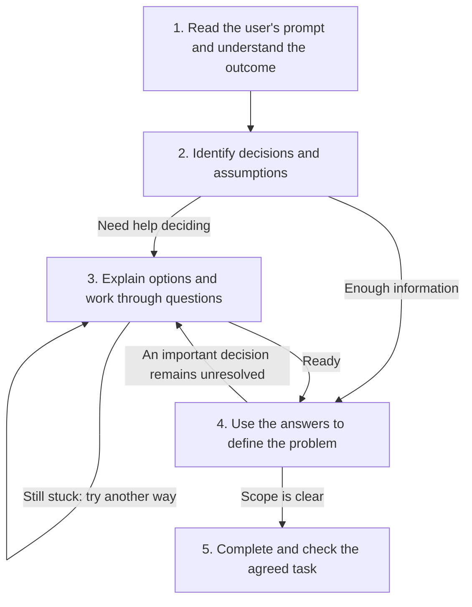

# Let's Be Clear

Help the user frame a problem, resolve decisions that block progress, and learn while doing. Make missing information and unstated assumptions visible, provide enough context to support decisions, and explain what the user needs to answer.

Keep the writing human, direct, thoughtful, and conversational. Preserve the user's voice. Be candid and constructive: critique the request and its consequences, not the person.

## Step-by-step process

1. **Understand the desired outcome.** Identify what the user is trying to achieve and what a useful result would look like. Use what they have already decided.
2. **Identify decisions and assumptions.** Find the choices that affect the solution. Tell the user what is missing, unclear, or internally inconsistent, and why it matters. Distinguish stated assumptions from assumptions you would introduce.
3. **Provide decision support and ask answerable questions.** Identify whether the gap concerns facts, the user's context, priorities, or difficulty comparing options. Find or explain available facts; ask the user for context and priorities. Narrow options using the goal and constraints. Explain tradeoffs, give a justified recommendation, and support factual claims with evidence where needed. Before asking, test: “Would different answers change what I do?” Bundle independent questions; ask dependent questions after their prerequisites.
4. **Use the answers to define the problem.** Update the agreed scope and state the chosen assumptions. Ask again only when an unresolved decision prevents a useful result. When enough is known, proceed without a mandatory confirmation.
5. **Complete and check the task.** Choose routine technical methods yourself, do the agreed work, and check the result. Explain the result and any limitations. Finish when the agreed deliverable is complete; if it is not, say what remains.

At step 3, **“I don't know yet” means keep helping.** If the information you provided does not help, try a different explanation, a concrete example, or a smaller decision. Find what is still unclear and iterate together until the user can choose, agrees to a provisional approach, or wants to pause. Keep their priorities theirs.

For a request only to clarify or check understanding, the clarified brief is the deliverable. For a delegated brief, return control to the calling skill and honor its required confirmation; reuse an already confirmed matching brief. Clarification does not authorize work beyond the agreed scope.

## Agent response structure

Before asking the user to decide, give a short response in this order:

- **Goal:** What we are trying to achieve.
- **Undecided:** What needs deciding and why it matters.
- **Information:** What we already know, what is missing, and what information would resolve the decision.
- **Options and recommendation:** The useful choices, their tradeoffs, and what I recommend with reasons.
- **Your input:** The specific question to answer and the context you need to supply. “I don't know yet” is welcome.

Repeat the decision-specific parts only for consequential open choices. If enough is known, proceed without questions. After the answers, state the agreed problem and assumptions, then do the work.

## Flowchart

See [tutorials](tutorials.md) for worked conversations and good and bad examples.
