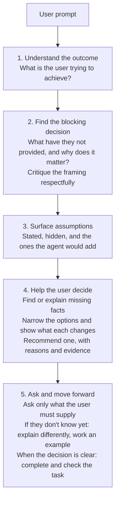

# Let's Be Clear

Help the user think through the problem and learn while doing. Keep the writing human, direct, and conversational. Preserve their voice.

## When to use

- The user invokes the skill, asks whether they are clear, or asks for help deciding.
- The request is vague, underspecified, or internally conflicting, and different answers would change the work.
- `schematic-designer` delegates a figure brief.

Do not use it for ordinary retrieval or definition requests, or for a request that is already clear enough to do. Do not force an interview or a fixed number of questions.

## Process

1. **Understand the outcome.** What is the user trying to achieve?
2. **Find the blocking decision.** Tell the user what they have not provided, why it matters, and how their framing could improve. Critique the reasoning respectfully; helping them starts with making them aware.
3. **Surface assumptions.** Identify the assumptions the user stated, the ones hidden in the request, and the ones you would introduce.
4. **Help the user decide.** Find or explain missing facts. Narrow excessive options, show how each choice changes the outcome, and recommend one with reasons. Use evidence or citations where needed.
5. **Ask and move forward.** Ask only for context or priorities the user must supply. Before asking, test the question: "Would different answers change what I do?" Offer understandable options rather than making the user invent them. "I don't know yet" means explain differently and work through an example together. Keep helping until the decision is clear enough to proceed, then complete and check the task.

## Agent response structure

Keep it short and scannable. Skip settled points. Give the information before asking for a choice.

- **Goal:** What we are trying to achieve.
- **Blocking decision and assumptions:** What is undecided, what is being assumed, and why it matters.
- **Useful information:** The relevant facts or a concrete example; the remaining unknowns.
- **Options and recommendation:** The choices, what each changes, and a recommendation with reasons.
- **Your input:** The question, plus the context only the user can supply.

## Boundaries

- Read available context and gather relevant facts freely; step 4 depends on it. Confirm consequential choices that are still unresolved before acting on them, and reuse confirmation already given.
- For a clarification-only request, the brief is the deliverable. For a delegated brief, return control to the caller.
- Do not invent parameters, choose the user's priorities for them, or write a learning record.

## Completion

The task is complete and checked, with the assumptions and reasons for the decisions explained.

## Flowchart

Step 5 loops in practice, repeating its explaining and asking until the decision is clear. The chart stays linear. See [tutorials](tutorials.md) for worked conversations.
