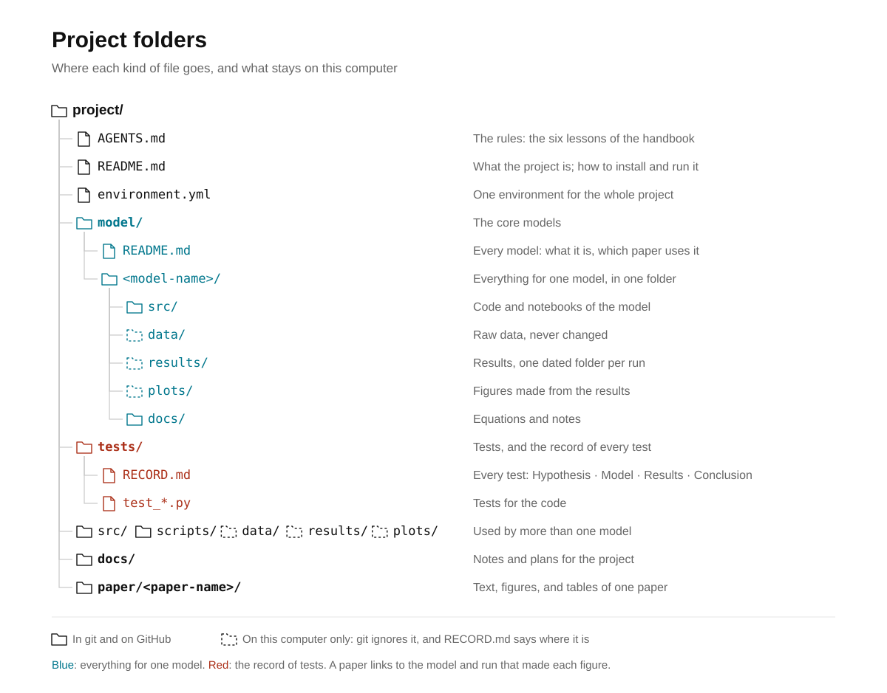

# [Project name]

[One sentence: what this project is.]

[A longer description: the research question, the models, and the papers this project supports.]

## Installation

```bash
conda env create -f environment.yml
conda activate [project-name]
python -m pip install -e .
```

[Replace with the real commands, or write "not set up yet".]

## Where things are



The folders of this project:

```text
project/
├── AGENTS.md           # Rules for agents
├── README.md           # This file
├── environment.yml
├── .gitignore
├── model/
│   ├── README.md       # Every model folder: what it is, what changed, which paper uses it
│   └── <model-name>/   # Everything for one model
│       ├── src/  data/  results/  plots/  docs/
├── tests/
│   ├── RECORD.md       # The one record of every test done
│   └── test_*.py       # Tests for the code
├── src/  scripts/  data/  results/  plots/   # Files used by more than one model
├── docs/
└── paper/<paper-name>/
```

[Keep only the folders this project has. Update the tree when a folder is added, moved, or removed.]

## How to run

| What | Command | What it shows |
| --- | --- | --- |
| Smallest example | [command, or "not set up yet"] | [the result to expect] |
| Tests for the code | `pytest` | [what passes] |
| Figures and tables of a paper | [`pipeline.sh` or `make`, or "not set up yet"] | [where the figures go] |

## Raw data

| Data | Folder | Where it came from |
| --- | --- | --- |
| [name] | [`data/…` or `model/<model-name>/data/…`] | [link, version, and the date it was downloaded] |

## Kept on this computer only

Results, figures, and large data are not in source control. `tests/RECORD.md` says for each test where its results are and how large they are.

## Papers

- [Link to each paper or preprint, with its folder in `paper/`.]

## Docs

- [Links to the notes and documentation in `docs/`.]

## License

[The license, or "not chosen yet".]
